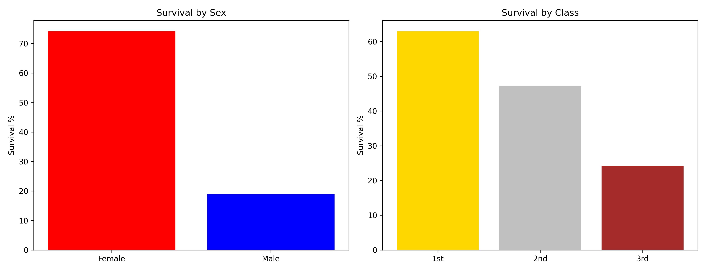
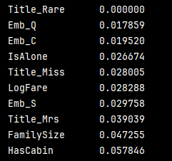
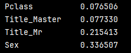

<a id="english-version"></a>
**English Version**

👉 [Перейти к русской версии / Jump to Russian version](#russian-version)  
*(Русская версия находится ниже / Russian version is below)*

---

# Titanic: a mini-experiment with pseudo-labeling and grouped CV

A small learning project on Kaggle Titanic. The goal was not to squeeze the maximum out of Public LB, but to build a tidy pipeline: meaningful features, pseudo-labels, honest validation, and a clear experiment structure.

## Table of Contents
- [1. Data and features](#1-data-and-features)
- [2. Model](#2-model)
- [3. Pseudo-labels](#3-pseudo-labels)
- [4. Validation and post-processing](#4-validation-and-post-processing)
- [5. Experiments](#5-experiments)
- [6. Why Public LB is identical and what GroupKFold gives](#6-why-public-lb-is-identical-and-what-groupkfold-gives)
- [7. Feature importance](#7-feature-importance)
- [8. On OOF and leakage](#8-on-oof-and-leakage)
- [9. Repository structure](#9-repository-structure)
- [10. How to run](#10-how-to-run)
- [11. Limitations](#11-limitations)
- [Summary](#summary)

## 1. Data and features

The task is to predict `Survived`: 0 — passenger died, 1 — survived.

Data:
- `train.csv` — 891 rows;
- `test.csv` — 418 rows.

What stands out right away:
- sex is the strongest feature: women survived about 74% of the time, men — 18%;
- class matters too: 1st class — about 63% survivors, 3rd — about 24%;
- age is useful, but there are about 20% missing values;
- `Fare` has a long right tail;
- `Cabin` is missing for 77%, but the mere fact that a cabin is listed already says something about status.



*Survival by sex and ticket class. The gap between sexes is larger than between classes.*

What I did with the features:

- Extracted the title from `Name` with the regex `r' ([A-Za-z]+)\.'`. Kept `Mr`, `Mrs`, `Miss`, `Master`, merged the rest into `Rare`.
- Filled missing `Age` not with the global median, but with the median per `Title + Pclass` pair. That way the age of a 1st-class `Mrs` and a 3rd-class `Mr` don't get mixed up.
- Family features: `FamilySize = SibSp + Parch + 1` and `IsAlone` (1 if the passenger is travelling alone).
- Log-transformed `Fare`: `LogFare = np.log1p(Fare)`.
- Turned `Cabin` into a binary `HasCabin`. Dropped the cabin number itself — too many unique values.

## 2. Model

The base is `XGBClassifier`. I tuned the parameters for stability on a small dataset, not for maximum LB:

```python
n_estimators=600
max_depth=3
learning_rate=0.02
subsample=0.75
colsample_bytree=0.65
```

I limited the depth so the model doesn't memorize noise. `learning_rate` is low, the number of trees is high.

## 3. Pseudo-labels

The test set can be used too, but carefully. The scheme is:

1. Train the model on train.
2. Predict probabilities on test.
3. Take the objects where the model is confident: `p > 0.90` or `p < 0.10`.
4. Add them to train with pseudo-labels.
5. Retrain the model.

I did exactly 2 iterations. More is worse: the model starts confirming its own mistakes — confirmation bias.

## 4. Validation and post-processing

Titanic has an unpleasant quirk: families often survived or died together. If relatives end up in both the train fold and the validation fold, the model is effectively peeking.

I compared two strategies:
- `StratifiedKFold(n_splits=10)` — the usual stratification by class;
- `StratifiedGroupKFold(n_splits=10)` — grouping by surname.

In the second case, all family members end up in only one fold. That's more honest.

Post-processing at the end:
- probability clipping `clip(0.02, 0.98)`;
- averaging snapshots at 400, 500, and 600 trees;
- blending between the `StratifiedKFold` and `GroupKFold` models.

Clipping removes the overconfident 0s and 1s. Snapshots smooth out the variance. Blending reduces dependence on a particular split.

## 5. Experiments

All versions live in `history/`.

| File | What changed | OOF Acc | OOF ROC-AUC | 0/1 |
|---|---|---|---|---|
| `01_baseline.py` | Base, 10 seeds, mean | 0.82155 | 0.86963 | 266 / 152 |
| `02_median_clip.py` | Median over seeds + clipping | 0.82155 | 0.86963 | 265 / 153 |
| `03_snapshots_21seeds.py` | 21 seeds + snapshots | 0.82379 | 0.86994 | 266 / 152 |
| `04_13seeds.py` | 13 seeds, no snapshots | 0.82379 | 0.87010 | 268 / 150 |
| `05_final_pipeline.py` | Blend of KFold + GroupKFold | **0.82716** | 0.86642 | 265 / 153 |
| `06_diagnostics.py` | Clone of base for Feature Importance | 0.82155 | 0.86963 | 266 / 152 |

Briefly on each iteration:

1. `01` — starting point. Clear what we're starting from.
2. `02` — median and clipping changed the prediction for exactly one passenger. Accuracy didn't change.
3. `03` — more seeds and snapshots gave a small boost.
4. `04` — fewer seeds, no snapshots. Same Accuracy, slightly higher ROC-AUC.
5. `05` — added honest validation by surname and blending. Best OOF Accuracy.
6. `06` — diagnostics, doesn't affect predictions.

## 6. Why Public LB is identical and what GroupKFold gives

All iterations produced Public LB `0.79665`. Not because the pipeline didn't change — the test set is just small, 418 objects. The Accuracy step:

```text
1 / 418 ≈ 0.00239
```

Different versions predicted between 150 and 153 survivors. A difference of 1–2 people doesn't cross the LB rounding boundary. Conclusion: on Titanic, Public LB is noisy, and for model selection it's better to look at OOF, where there are 891 objects.

The submission files themselves are in [`history/submissions/`](history/submissions/) — they show that the versions differ by 1–2 passengers.

After switching to `GroupKFold`, ROC-AUC dropped and Accuracy went up. That's normal: the model is no longer peeking at families. The probabilities become less confident, so AUC goes down. But the binary decisions become more accurate, so Accuracy goes up. That is, the final model is less pretty in terms of probabilities, but more honest in terms of decisions.

## 7. Feature importance

Top features per `06_diagnostics.py`:

| Feature | Weight |
|---|---|
| `Sex` | 0.336 |
| `Title_Mr` | 0.215 |
| `Title_Master` | 0.077 |
| `Pclass` | 0.076 |
| `HasCabin` | 0.057 |

`Title_Rare` got a weight of 0.000. The group is too small and heterogeneous: priests, doctors, aristocrats. There's no stable pattern in it.




## 8. On OOF and leakage

The OOF metrics in the table refer to the base architectures. I deliberately don't evaluate the final model with pseudo-labels via OOF.

The reason is simple: pseudo-labels come from test. If you add them to train and then validate on train folds, you get leakage. The metric becomes inflated and useless. So I use OOF to compare base approaches, and the final reference is Public LB.

## 9. Repository structure

```text
Titanic-project_ML/
├── data/
│   ├── train.csv                       # training set (891 rows, with labels)
│   └── test.csv                        # test set (418 rows, no labels)
├── history/
│   ├── submissions/                    # CSV submissions for each of the 6 versions
│   ├── 01_baseline.py                  # starting model: 10 seeds, mean averaging
│   ├── 02_median_clip.py               # median over seeds + clipping [0.02, 0.98]
│   ├── 03_snapshots_21seeds.py         # 21 seeds + snapshots at 400/500/600 trees
│   ├── 04_13seeds.py                   # 13 seeds, no snapshots (speed check)
│   ├── 05_final_pipeline.py            # blend of StratifiedKFold + GroupKFold (best OOF Acc)
│   └── 06_diagnostics.py               # clone of 01_baseline for Feature Importance
├── images/
│   ├── eda_plot.png                    # survival chart by sex and class
│   ├── feature_importance.png          # feature weights from XGBoost, part 1
│   └── feature_importance2.png         # feature weights from XGBoost, part 2
├── final_pipeline.py                   # local version with assert checks and leakage protection
├── submission.csv                      # reference submission (output of final_pipeline.py)
├── requirements.txt                    # pinned library versions
├── README.md                           # project description (this file)
└── LICENSE                             # MIT
```

`history/05_final_pipeline.py` — the archived Kaggle version.  
`final_pipeline.py` — the local version with data checks and leakage protection.

## 10. How to run

```bash
pip install -r requirements.txt
python final_pipeline.py
```

The output will be `submission.csv`. It should match the reference file in the root.

## 11. Limitations

There's little data: 891 objects, so the metrics are noisy.

Adversarial validation gave an AUC of about `0.5296`. That means train and test are similar. The main problem is overfitting, not distribution shift.

Public LB on Titanic is too coarse. If you optimize only for it, it's easy to overfit to the test set.

## Summary

In the end, a small learning pipeline came together:
- features are built with meaning, not just "add everything";
- pseudo-labels are used sparingly, 2 iterations;
- validation by surname protects against peeking at families;
- blending and clipping reduce variance;
- experiment results are saved and reproducible.

The best OOF Accuracy is `0.82716` for version `05_final_pipeline.py`. Public LB is identical for all versions, but that's a limitation of the metric, not an absence of changes.


---


<a id="russian-version"></a>
**Русская версия**

👉 [Jump to English version / Перейти к английской версии](#english-version)

# Titanic: мини-эксперимент с pseudo-labeling и групповой CV

Небольшой учебный проект по Kaggle Titanic. Цель была не выбить максимум Public LB, а собрать аккуратный пайплайн: осмысленные признаки, псевдо-метки, честная валидация и понятная структура экспериментов.

## Оглавление
- [1. Данные и признаки](#1-данные-и-признаки)
- [2. Модель](#2-модель)
- [3. Псевдо-метки](#3-псевдо-метки)
- [4. Валидация и пост-обработка](#4-валидация-и-пост-обработка)
- [5. Эксперименты](#5-эксперименты)
- [6. Почему Public LB одинаковый и что даёт GroupKFold](#6-почему-public-lb-одинаковый-и-что-даёт-groupkfold)
- [7. Важность признаков](#7-важность-признаков)
- [8. Про OOF и утечку](#8-про-oof-и-утечку)
- [9. Структура репозитория](#9-структура-репозитория)
- [10. Как запустить](#10-как-запустить)
- [11. Ограничения](#11-ограничения)
- [Итог](#итог)

## 1. Данные и признаки

Нужно предсказать `Survived`: 0 — пассажир погиб, 1 — выжил.

Данные:
- `train.csv` — 891 строка;
- `test.csv` — 418 строк.

Что видно сразу:
- пол — самый сильный признак: женщины выживали примерно в 74% случаев, мужчины — в 18%;
- класс тоже важен: 1-й класс — около 63% выживших, 3-й — около 24%;
- возраст полезен, но есть около 20% пропусков;
- `Fare` имеет длинный правый хвост;
- `Cabin` пропущена у 77%, но сам факт наличия каюты уже что-то говорит о статусе.


*Выживаемость по полу и классу билета. Разрыв между полами больше, чем между классами.*

Что сделал с признаками:

- Из `Name` вытащил титул регуляркой `r' ([A-Za-z]+)\.'`. Оставил `Mr`, `Mrs`, `Miss`, `Master`, остальные свёл в `Rare`.
- Пропуски в `Age` заполнял не общей медианой, а медианой по паре `Title + Pclass`. Так возраст для `Mrs` из 1-го класса и `Mr` из 3-го не смешивается.
- Семейные признаки: `FamilySize = SibSp + Parch + 1` и `IsAlone` (1, если пассажир один).
- `Fare` залогарифмировал: `LogFare = np.log1p(Fare)`.
- Из `Cabin` сделал бинарный `HasCabin`. Сам номер каюты выкинул — слишком много уникальных значений.

## 2. Модель

Основа — `XGBClassifier`. Параметры подбирал не под максимум LB, а под стабильность на маленьком датасете:

```python
n_estimators=600
max_depth=3
learning_rate=0.02
subsample=0.75
colsample_bytree=0.65
```

Глубину ограничил, чтобы модель не запоминала шум. `learning_rate` низкий, деревьев много.

## 3. Псевдо-метки

Тестовую выборку тоже можно использовать, но осторожно. Схема такая:

1. Обучаю модель на train.
2. Предсказываю вероятности на test.
3. Беру объекты, где модель уверена: `p > 0.90` или `p < 0.10`.
4. Добавляю их в train с псевдо-метками.
5. Переобучаю модель.

Сделал ровно 2 итерации. Больше — хуже: модель начинает подтверждать свои же ошибки, получается confirmation bias.

## 4. Валидация и пост-обработка

На Titanic есть неприятная штука: семьи часто выживали или погибали вместе. Если родственники попадают и в train-фолд, и в validation-фолд, модель фактически подглядывает.

Сравнил две стратегии:
- `StratifiedKFold(n_splits=10)` — обычная стратификация по классу;
- `StratifiedGroupKFold(n_splits=10)` — группировка по фамилии.

Во втором случае все члены семьи попадают только в один фолд. Это честнее.

Пост-обработка в конце:
- клиппинг вероятностей `clip(0.02, 0.98)`;
- усреднение снапшотов на 400, 500 и 600 деревьях;
- блендинг между моделями со `StratifiedKFold` и `GroupKFold`.

Клиппинг убирает слишком уверенные 0 и 1. Снапшоты сглаживают разброс. Блендинг снижает зависимость от конкретного разбиения.

## 5. Эксперименты

Все версии лежат в `history/`.

| Файл | Что менял | OOF Acc | OOF ROC-AUC | 0/1 |
|---|---|---|---|---|
| `01_baseline.py` | База, 10 сидов, среднее | 0.82155 | 0.86963 | 266 / 152 |
| `02_median_clip.py` | Медиана по сидам + клиппинг | 0.82155 | 0.86963 | 265 / 153 |
| `03_snapshots_21seeds.py` | 21 сид + снапшоты | 0.82379 | 0.86994 | 266 / 152 |
| `04_13seeds.py` | 13 сидов, без снапшотов | 0.82379 | 0.87010 | 268 / 150 |
| `05_final_pipeline.py` | Блендинг KFold + GroupKFold | **0.82716** | 0.86642 | 265 / 153 |
| `06_diagnostics.py` | Клон базы для Feature Importance | 0.82155 | 0.86963 | 266 / 152 |

Коротко по итерациям:

1. `01` — стартовая точка. Понятно, от чего отталкиваться.
2. `02` — медиана и клиппинг поменяли предсказание ровно одному пассажиру. Accuracy не изменилась.
3. `03` — больше сидов и снапшоты дали небольшой прирост.
4. `04` — уменьшил число сидов, убрал снапшоты. Accuracy та же, ROC-AUC чуть выше.
5. `05` — добавил честную валидацию по фамилиям и блендинг. Лучшая OOF Accuracy.
6. `06` — диагностика, на предсказания не влияет.

## 6. Почему Public LB одинаковый и что даёт GroupKFold

Все итерации дали Public LB `0.79665`. Это не потому, что пайплайн не менялся — просто тест маленький, 418 объектов. Шаг Accuracy:

```text
1 / 418 ≈ 0.00239
```

Разные версии предсказывали от 150 до 153 выживших. Разница в 1–2 человека не переходит границу округления LB. Вывод: на Titanic Public LB шумный, для выбора модели лучше смотреть на OOF, где 891 объект.

Сами файлы сабмитов лежат в [`history/submissions/`](history/submissions/) — по ним видно, что версии отличаются на 1–2 пассажира.

После перехода к `GroupKFold` ROC-AUC упал, а Accuracy вырос. Это нормально: модель больше не подглядывает за семьями. Вероятности становятся менее уверенными, поэтому AUC ниже. Зато бинарные решения становятся аккуратнее, поэтому Accuracy выше. То есть финальная модель менее красива по вероятностям, но честнее по решениям.

## 7. Важность признаков

Топ признаков по `06_diagnostics.py`:

| Признак | Вес |
|---|---|
| `Sex` | 0.336 |
| `Title_Mr` | 0.215 |
| `Title_Master` | 0.077 |
| `Pclass` | 0.076 |
| `HasCabin` | 0.057 |

`Title_Rare` получил вес 0.000. Группа слишком маленькая и разнородная: священники, врачи, аристократы. Устойчивой закономерности там нет.


## 8. Про OOF и утечку

В таблице OOF-метрики относятся к базовым архитектурам. Финальную модель с псевдо-метками по OOF специально не оцениваю.

Причина простая: псевдо-метки берутся из test. Если добавить их в train и потом валидировать на train-фолдах, будет утечка. Метрика станет завышенной и бесполезной. Поэтому OOF использую для сравнения базовых подходов, а финальный ориентир — Public LB.

## 9. Структура репозитория

```text
Titanic-project_ML/
├── data/
│   ├── train.csv                       # обучающая выборка (891 строка, с метками)
│   └── test.csv                        # тестовая выборка (418 строк, без меток)
├── history/
│   ├── submissions/                    # CSV-сабмиты для каждой из 6 версий
│   ├── 01_baseline.py                  # стартовая модель: 10 сидов, усреднение mean
│   ├── 02_median_clip.py               # median по сидам + клиппинг [0.02, 0.98]
│   ├── 03_snapshots_21seeds.py         # 21 сид + снапшоты на 400/500/600 деревьях
│   ├── 04_13seeds.py                   # 13 сидов, без снапшотов (проверка ускорения)
│   ├── 05_final_pipeline.py            # блендинг StratifiedKFold + GroupKFold (лучшая OOF Acc)
│   └── 06_diagnostics.py               # клон 01_baseline для Feature Importance
├── images/
│   ├── eda_plot.png                    # график выживаемости по полу и классу
│   ├── feature_importance.png          # важность признаков из XGBoost, часть 1
│   └── feature_importance2.png         # важность признаков из XGBoost, часть 2
├── final_pipeline.py                   # локальная версия с assert-проверками и защитой от утечки
├── submission.csv                      # эталонный сабмит (результат final_pipeline.py)
├── requirements.txt                    # зафиксированные версии библиотек
├── README.md                           # описание проекта (этот файл)
└── LICENSE                             # MIT
```

`history/05_final_pipeline.py` — архивная версия с Kaggle.  
`final_pipeline.py` — локальная версия с проверками данных и защитой от утечки.

## 10. Как запустить

```bash
pip install -r requirements.txt
python final_pipeline.py
```

На выходе будет `submission.csv`. Он должен совпасть с эталонным файлом в корне.

## 11. Ограничения

Данных мало: 891 объект, поэтому метрики шумные.

Adversarial validation дала AUC около `0.5296`. Это значит, что train и test похожи. Главная проблема — переобучение, а не сдвиг распределений.

Public LB на Titanic слишком грубый. Если оптимизировать только его, легко переобучиться на тест.

## Итог

В итоге получился небольшой учебный пайплайн:
- признаки сделаны по смыслу, а не просто «добавим всё»;
- псевдо-метки используются ограниченно, 2 итерации;
- валидация по фамилиям защищает от подглядывания за семьями;
- блендинг и клиппинг снижают разброс;
- результаты экспериментов сохранены и воспроизводимы.

Лучшая OOF Accuracy — `0.82716` у версии `05_final_pipeline.py`. Public LB у всех версий одинаковый, но это ограничение метрики, а не отсутствие изменений.
